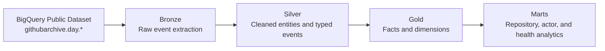

# GitHub Medallion Warehouse on BigQuery

Enterprise-style analytics engineering project that models GitHub Archive public
events into a Medallion Architecture using dbt Core and BigQuery.

## Project Goal

This project demonstrates how to build a production-grade Modern Data Warehouse
using high-volume event data from GitHub Archive. The warehouse is designed to
showcase advanced SQL, dbt modeling, BigQuery performance optimization, testing,
and documentation practices.

## Dataset

Primary source: `githubarchive.day.*`

GitHub Archive is a public event stream containing repository, actor, issue,
pull request, release, watch, fork, and push activity from GitHub. It is a strong
portfolio dataset because it combines large scale, semi-structured JSON payloads,
nested arrays, event analytics, and realistic product-style behavioral data.

## Architecture



```text
BigQuery Public Dataset: githubarchive.day.*
        |
        v
Bronze: raw event extraction, JSON parsing, commit UNNEST
        |
        v
Silver: cleaned entities, typed events, deduplicated business records
        |
        v
Gold: star schema facts, dimensions, and analytical marts
```

## Implemented Scope

Implemented end to end:

- dbt Core project structure.
- BigQuery profile example.
- Bronze incremental model over GitHub Archive daily wildcard tables.
- Silver cleaned event, entity, issue, pull request, and push commit models.
- Gold star schema dimensions and facts.
- Analytics marts for repository activity, actor contributions, and project health.
- Partitioning by `event_created_at`.
- Clustering by high-cardinality keys such as event type, repository, actor, and commit SHA.
- JSON extraction from GitHub payloads.
- Commit array flattening with `UNNEST()`.
- Window functions for deduplication, lifecycle sequencing, rolling metrics, and rankings.
- dbt tests, model documentation, singular tests, and reference seed data.

## Star Schema

Dimensions:

- `dim_actor`
- `dim_repository`
- `dim_organization`
- `dim_event_type`
- `dim_date`

Facts:

- `fact_github_events`
- `fact_pull_requests`
- `fact_issues`
- `fact_pushes`

Marts:

- `mart_repository_activity_daily`
- `mart_actor_contributions_daily`
- `mart_open_source_project_health`

## Cost Controls

The project uses conservative defaults to prevent accidental large scans:

- `bronze_start_date`: `2024-01-01`
- `bronze_end_date`: `2024-01-07`

Override these variables when running dbt:

```bash
dbt run --select bronze --vars '{bronze_start_date: "2024-01-01", bronze_end_date: "2024-01-31"}'
```

## Local Setup

Install dbt BigQuery:

```bash
python -m venv .venv
source .venv/bin/activate
pip install -r requirements.txt
dbt deps
```

Copy the example profile into your dbt profiles directory and update the GCP
project:

```bash
mkdir -p ~/.dbt
cp profiles.yml.example ~/.dbt/profiles.yml
```

Authenticate with Google Cloud:

```bash
gcloud auth application-default login
```

Run the full warehouse:

```bash
dbt seed
dbt run
dbt test
```

Run only one layer:

```bash
dbt run --select tag:bronze
dbt run --select tag:silver
dbt run --select tag:gold
dbt run --select tag:mart
```

Generate documentation:

```bash
dbt docs generate
dbt docs serve
```

Lint SQL:

```bash
export GCP_PROJECT_ID="your-gcp-project-id"
export GCP_SERVICE_ACCOUNT_JSON='{"type":"service_account", "...":"..."}'
sqlfluff lint models tests analyses
```

## CI/CD

The repository includes a GitHub Actions workflow at `.github/workflows/dbt-ci.yml`.

To enable full CI after uploading to GitHub, add these repository secrets:

- `GCP_PROJECT_ID`
- `GCP_SERVICE_ACCOUNT_JSON`

The workflow installs dependencies, runs `dbt deps`, compiles the dbt project,
and runs SQLFluff linting.

## Repository Structure

```text
.
├── .github/workflows/
├── .ci/
├── models/
│   ├── bronze/
│   ├── silver/
│   ├── gold/
│   └── marts/
├── macros/
├── tests/
├── analyses/
├── seeds/
├── docs/
└── tests/
```

## Portfolio Talking Points

- Designed a Medallion Architecture on BigQuery using dbt Core.
- Modeled semi-structured GitHub event data into a dimensional warehouse.
- Used BigQuery wildcard tables and `_TABLE_SUFFIX` filters to control scan cost.
- Implemented partitioned and clustered models for scalable analytics.
- Flattened nested commit arrays using `UNNEST()`.
- Applied window functions for deduplication, sequencing, rolling seven-day metrics, and daily ranking.
- Protected sensitive commit author emails by hashing them in the Silver layer.
- Added CI-ready dbt compilation and SQL linting with GitHub Actions and SQLFluff.
